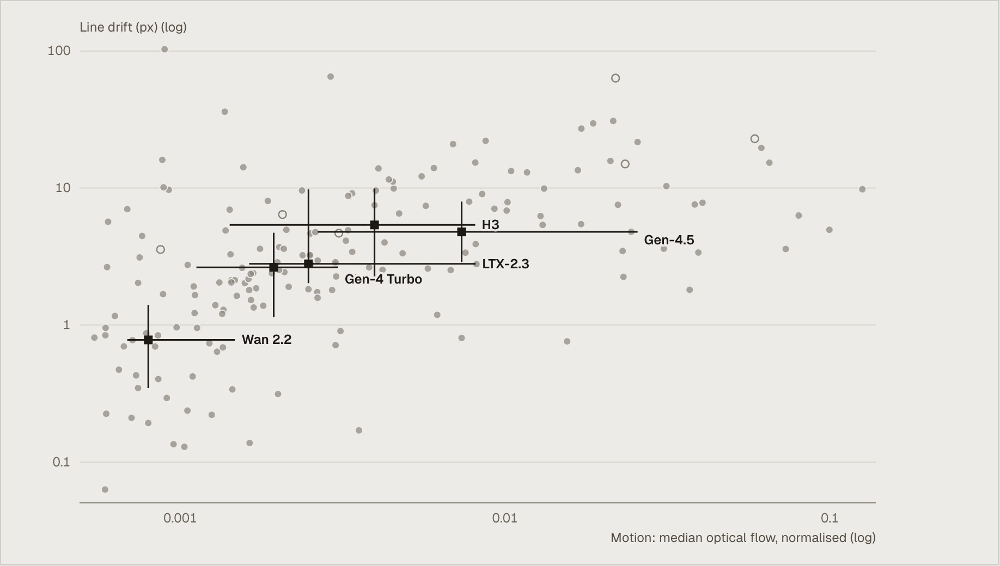
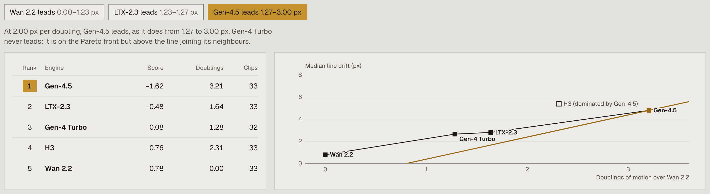

# Stability ranks stillness

The steadiest engine in StillDrawn is the one that barely moves.

StillDrawn is an open benchmark of 373 short clips, with a paper. Each clip starts from a black-and-white ink panel. A video model is asked to animate it in one of three ways: idle motion, a short burst of action, or a slow camera push. Every prompt also asks for the drawing to stay exactly as drawn. Five metrics then measure what each clip kept: its lines, screentone, edges, style and closed shapes.

On line drift, how far the line art wanders from the first frame, Wan 2.2 wins easily. Its median is 0.78 px, against 2.64 for Gen-4 Turbo, 2.80 for LTX-2.3, 4.79 for Gen-4.5 and 5.38 for MiniMax H3.

It also moves the least. Measured by optical flow, Gen-4.5 moves 9.2 times as much as Wan 2.2, and 3.8 times as much as Gen-4 Turbo. A clip that doesn't move at all would score perfectly on every metric in the suite. So the league is, in large part, a ranking of who did least.

## What it explores

[StillDrawn Explorer](https://stilldrawn.studionephele.com) turns that finding into something you can steer.

Pick a panel and an engine, and the clip plays beside the drawing it came from. Under it, a curve plots line drift frame by frame. Scrub the curve and the clip follows. A difference view lays the clip over its own first frame, so anything black hasn't changed. All 373 clips are there, byte for byte as released, so the 288 that carry content credentials still do.

The scatter puts motion on one axis and drift on the other, with one cross per engine (Figure 1). The Stillness Tax tab does what the paper declined to do: it sets an exchange rate between stability and motion. You decide how many pixels of drift a doubling of motion is worth, and watch the leaderboard move. The engine that barely moves pays for it. The tab is labelled exploratory, because the motion measure was added after the clips were made (pre-registration amendment A6).

*Figure 1. Motion against line drift for the 164 standard clips, both axes on a log scale. Each cross is an engine's median, with its interquartile range. Hollow points are six clips generated between a first and a last frame; no comparison uses them. The engines that move more drift more. [Open it in the explorer](https://stilldrawn.studionephele.com/scatter).*

## Why it matters

Across the five engines, median motion and median line drift rank together at ρ = 0.90 (Spearman's rank correlation). The two orderings match except that the last two engines swap places. The same link holds inside four of the five engines, at ρ 0.38 to 0.58. Wan 2.2 is the exception, at −0.007. It moves so little that there is almost no motion for drift to follow.

None of this is special to ink. Any metric that rewards a clip for staying like its first frame is maximised by a clip that doesn't move. VBench, a widely used video benchmark, pairs its consistency scores with a motion score for this reason. Published without motion beside it, a stability leaderboard is mostly a stillness leaderboard.

Matching doesn't rescue it. A matched-motion comparison sets two engines side by side only where their motion ranges overlap. Five of the ten pairs have enough clips for that, and two of those five reverse. H3, last on line drift, beats Gen-4 Turbo at equal movement, and so does LTX-2.3. Wan 2.2 can't be compared with any other engine at equal motion.

## What it suggests

If stillness scores for free, a ranking is a choice someone made for you. The Stillness Tax shows the choice (Figure 2).

At a price of zero you get the paper's order, and Wan 2.2 leads. It keeps the lead until a doubling of motion is worth 1.23 px of drift. LTX-2.3 then leads for a sliver. From 1.27 px, Gen-4.5 leads, because it moves more, not because it looks better. Gen-4 Turbo is on the Pareto front, since no engine both moves more and drifts less, but it never leads at any price.

*Figure 2. The Stillness Tax with the price set past 1.27 px, where Gen-4.5 leads. Each engine's score is its median line drift minus the price for every doubling of motion it has over Wan 2.2; the lowest score leads. The leader changes at 1.23 and 1.27 px per doubling. [Move the slider yourself](https://stilldrawn.studionephele.com/tax?lens=price&p=2).*

None of these prices is the right one, and that is the point. Generated video is supposed to move: a camera push should push. A benchmark that scores only what stays the same will keep rewarding models for not doing the job. Stability scores need motion reported beside them, and readers should be able to see what a ranking costs.

**The honest limits**
- **Five engines.** With five points, ρ = 0.90 has an exact p of 0.083: suggestive, not proven.
- **Thin comparisons.** A matched-motion comparison counts only when each engine has at least five clips in the overlap, so half the pairs drop out.
- **Few failure tags.** They come from 24 clips reviewed frame by frame.
- **Modest human agreement.** People agree only loosely on whether a clip still looks hand-drawn (Krippendorff's α 0.21).
- **Motion came later.** The motion measure was added after the fact, so it qualifies the results rather than restating them.

The next test is the obvious one: measure drift only where the requested motion shouldn't reach, and see whether the order survives.

Data: StillDrawn dataset (Aaron Smiles, 2026), CC BY 4.0, [doi:10.5281/zenodo.23072784](https://doi.org/10.5281/zenodo.23072784).

The same argument, told the other way round: [THESIS-object-first.md](THESIS-object-first.md).
